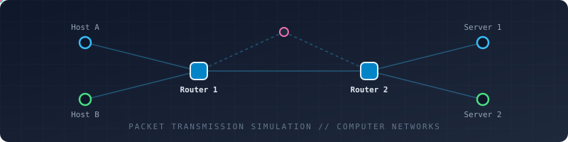

  

# Konsep Jaringan - Semester 3[cite: 1]

Repositori/Direktori ini berisi tugas, catatan, dan materi untuk mata kuliah **Konsep Jaringan** pada Semester 3 di **Politeknik Elektronika Negeri Surabaya (PENS)**[cite: 1].

## Identitas Mahasiswa[cite: 1]
- **Nama:** Mohammad Ihsan Septiano Firdaus[cite: 1]
- **NRP:** 3125600041[cite: 1]
- **Program Studi:** Sarjana Terapan Teknik Informatika[cite: 1]
- **Mata Kuliah:** Konsep Jaringan (Teori)[cite: 1]
- **Semester:** 3[cite: 1]

## Dosen Pengampu[cite: 1]
- **Nama Dosen:** Dr. Ferry Astika Saputra, ST, M.Sc. (197708232001121002)[cite: 1]

## Deskripsi[cite: 1]
Dokumen ini dan folder terkait digunakan untuk keperluan pengumpulan tugas dan dokumentasi pembelajaran selama mengikuti mata kuliah Konsep Jaringan[cite: 1].
